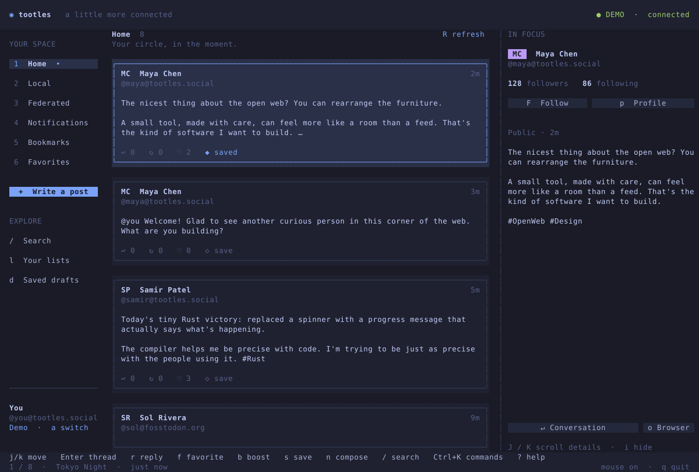

# tootles

**Your corner of the open web.** A thoughtful, keyboard-first Mastodon and Bluesky client, built in Rust for the terminal. Tokyo Night by default. Mouse support throughout. At home in a Hyprland workspace, a laptop terminal, or a quiet SSH session.



## Install the CLI

### Requirements

| Use | Requirements |
| --- | --- |
| Build from source | **Rust 1.90+**, Cargo, and a C compiler/linker such as GCC or Clang. Install the toolchain with [rustup](https://rustup.rs). |
| Run the installed CLI | An interactive UTF-8 terminal and a writable configuration directory. A true-color terminal is recommended; no Nerd Font is required. |
| Connect to Mastodon | A Mastodon account and network access to its HTTPS server. Browser OAuth opens through `xdg-open` on Linux or `open` on macOS; the authorization URL can also be opened manually. |
| Connect to Bluesky | A Bluesky account, an app password, and HTTPS access to your account host. Tootles saves session tokens and refreshes them as needed; the app password is not saved. |
| View inline images | Kitty, Sixel, or iTerm2 graphics support for pixel images. Other terminals, including Alacritty, use colored half-block previews. No external image viewer is needed. |
| Open original images in the default viewer | An image application associated with the file type. Linux also needs `xdg-open` from `xdg-utils`; macOS uses `open`. No particular image viewer or mpv is required. |
| Play video or audio | The optional **mpv** executable on `PATH`. Window mode needs a graphical desktop; Terminal mode needs mpv's `kitty` or `tct` output. Alacritty uses `tct`. Playback is tested with **mpv 0.41.0**. |
| Run the optional regression scripts | Python 3.11+ on a Unix system with PTY support; video tests also need **ffmpeg** and mpv. Python and the ffmpeg executable are development-test dependencies, not dependencies of the installed CLI. |

**Platform status:** Linux is built and tested. Apple Silicon macOS builds and passes the test suite natively in the release workflow, but interactive terminal use on macOS is still unverified. Native Windows support is incomplete: default configuration paths, credential permissions, testing, and packaging still need work.

On Debian or Ubuntu, install the source-build tools with `sudo apt install build-essential`. For optional playback and opening browsers or default applications, install `sudo apt install mpv xdg-utils`. Other distributions can use their equivalent packages. Check `mpv --vo=help` for available video outputs. Hyprland is optional; Tootles runs inside your chosen terminal.

### Install a release build

Prebuilt archives are published on [GitHub Releases](https://github.com/tootles-dev/tootles/releases/latest). The current release is [v0.2.0](https://github.com/tootles-dev/tootles/releases/tag/v0.2.0):

| Platform | Archive |
| --- | --- |
| Linux x86_64 | `tootles-v0.2.0-x86_64-unknown-linux-gnu.tar.gz` |
| Linux ARM64 | `tootles-v0.2.0-aarch64-unknown-linux-gnu.tar.gz` |
| Apple Silicon macOS | `tootles-v0.2.0-aarch64-apple-darwin.tar.gz` |

Each archive comes with a SHA-256 checksum, a **Sigstore signature**, and **GitHub build provenance**. [Verify the download](docs/releases.md#verify-and-install-a-download) before extracting and installing it. The installed executable does not require Rust or Cargo. Linux release builds target Ubuntu 24.04 or a compatible newer glibc system; build from source on older or musl-based distributions. Native Windows packages are not available yet.

### Build and launch

```sh
git clone https://github.com/tootles-dev/tootles.git
cd tootles
cargo install --locked --path .

tootles --demo
```

Cargo installs a standalone `tootles` executable into `~/.cargo/bin`. Make sure that directory is on `PATH`. You do not need the repository or Cargo to run the installed binary. Alternatively, `./scripts/install.sh` installs under `~/.local` (override with `TOOTLES_INSTALL_ROOT`).

After updating the checkout, reinstall with `cargo install --locked --path . --force`. Run `tootles --version` to verify which build is on `PATH`.

```sh
tootles login mastodon.social   # use your own Mastodon server
tootles                        # open your connected account
tootles accounts               # list accounts without exposing tokens
tootles switch 2               # choose your default account
tootles theme tokyo-night      # persist your preferred theme
tootles doctor                 # inspect terminal/configuration setup
```

Mastodon `login` opens your server's authorization page; approve Tootles, then paste the displayed authorization code into the terminal. The client never asks for your Mastodon password. For an existing access token, use `tootles login SERVER --token-stdin` and supply it on standard input, or set `TOOTLES_TOKEN` for that command. Tokens need `read write follow` scopes. Do not put tokens in command arguments.

### Add a Bluesky account

Create a dedicated app password in [Bluesky Settings → App passwords](https://bsky.app/settings/app-passwords), then run:

```sh
tootles login --provider bluesky your-handle.bsky.social
tootles
```

Enter the app password at the hidden prompt. Use your handle, including its domain, or your DID. For an account on another host, add `--pds https://your-pds.example`. For scripting, `--app-password-stdin` reads the app password from standard input; never put it in command arguments. Mastodon login stays `tootles login YOUR_SERVER`.

Press **a** in the TUI to switch between Mastodon, Bluesky, and the offline demo. `tootles accounts` lists the saved accounts; `tootles switch NUMBER` chooses the next launch's account. Each account keeps separate drafts. See [Bluesky setup and supported features](docs/bluesky.md).

Without a connected account, Tootles clearly labels and opens its offline demo. Demo posts, reactions, relationships, lists, and votes live in memory; drafts and preferences persist locally. The demo does not contact a social server.

## What is included

- **Timelines:** home, local, federated, favorites, bookmarks, lists, hashtags, and account profiles. Pagination loads older entries as you reach the bottom. Refresh preserves your selected post when possible.
- **Conversations:** parent and child posts, replies, content warnings, visibility, boost attribution, and edited-post markers.
- **Notifications:** mentions, follows, favorites, boosts, and other server notification types, with links to their author or conversation.
- **Search:** posts, people, and hashtags. Use the command palette's “Show people from search” to browse account results.
- **Compose:** multiline Unicode editing, replies, content warnings, four visibility levels, language, media with alt text, and single- or multiple-choice polls. Edit and delete your own posts. Drafts autosave locally and are separated by account.
- **Interactions:** favorite, boost, bookmark, follow/unfollow, mute/unmute, block/unblock, vote, open in browser, create lists, and add an author to a list.
- **Accounts:** Mastodon browser OAuth or verified token login, Bluesky app-password login with renewable sessions, account switching, local logout, and separate credentials/drafts.
- **Interface:** responsive navigation/timeline/inspector panes, clickable controls, mouse scrolling, command palette, contextual shortcuts, reduced motion, compact mode, and four themes: **Tokyo Night**, Midnight, Paper, and High Contrast.
- **Media gallery:** inline image previews for posts and local attachments, full alt text, and optional mpv video/audio playback in a window or the terminal.
- **Networks:** Mastodon and Bluesky adapters share the interface. Controls follow the active network’s capabilities; Bluesky uses public posts and image uploads, while Mastodon also offers visibility choices, polls, and editing. A stateful offline demo and the asynchronous `SocialProvider` trait support development of other adapters.

The feature list above describes the client as a whole; see the [Bluesky feature table](docs/bluesky.md#supported-features) for network-specific support.

Network requests run in background tasks. Account and request generations keep stale responses from replacing the current view. Mastodon reads retry transient connection errors. Bluesky refreshes expired sessions and retries requests after an explicit authentication rejection; ambiguous write failures are not automatically replayed. Publishing carries an idempotency key to make an intentional retry safe. Server hide/warn filters and sensitive content are respected by the adapter and interface.

## Keyboard and mouse

Press **?** at any time outside an input for help, or **Ctrl+K** / **:** for the searchable command palette.

| Key | Action |
| --- | --- |
| `j` / `k`, `↓` / `↑` | Next / previous post |
| `PgDown` / `PgUp`, `Space` | Move through the timeline |
| `g` / `G`, `Home` / `End` | First / last loaded post |
| `1` / `2` / `3` | Home / local / federated |
| `4` / `5` / `6` | Notifications / bookmarks / favorites |
| `Enter` | Open conversation |
| `Backspace` / `←` | Previous view |
| `n` / `r` | New post / reply |
| `f` / `b` / `s` | Favorite / boost / bookmark |
| `p` / `F` | Author profile / follow or unfollow |
| `/` / `#` | Search / browse hashtag |
| `x` | Reveal or hide content warning / sensitive media |
| `m` / `o` | Media gallery / post in browser |
| `L` | Choose an HTTP or HTTPS link from the selected post |
| `v` / `e` | Vote / edit your post |
| `a` / `l` / `d` | Accounts / lists / drafts |
| `T` / `c` / `i` | Cycle themes / compact mode / inspector |
| `J` / `K` | Scroll the inspector |
| `R` | Refresh |
| `q` / `Ctrl+C` | Save the current draft and quit |

Click navigation items, post cards, action chips, fields, and modal controls. The wheel moves through posts or scrolls the inspector when hovered. Hold your terminal's text-selection modifier (often Shift) to select terminal text, or launch with `--no-mouse`.

Post URLs are underlined and clickable, including links wrapped across lines. Press `L` or click the post's **Links** action to choose among its destinations; arrows select, `Enter` or a click opens the link, and `Esc` closes the picker. `o` opens the post itself on its network. Only HTTP and HTTPS destinations without embedded credentials are offered, and links behind a content warning remain hidden until you reveal the post.

### Writing a post

Use `Tab` / `Shift+Tab` to cycle body, content warning, attachment path, alt text, poll options, and language. Standard arrows, Home/End, and grapheme-aware Backspace/Delete work in inputs; bracketed paste supports multiline text. `Ctrl+U` clears text before the cursor and `Ctrl+W` deletes a word.

| Key | Composer action |
| --- | --- |
| `Ctrl+Enter` or `F4` | Publish (F4 works when a terminal cannot distinguish Ctrl+Enter) |
| `Ctrl+S` | Save a local draft |
| `Esc` | Save and close the draft |
| `Alt+V` or `F2` | Public → unlisted → followers → mentioned only |
| `F3` or `Alt+B` | Browse for an image, video, or audio file |
| `Alt+A` | Add the selected file and its description to the post |
| `Alt+S` | Toggle sensitive media |
| `Alt+P` | Single / multiple choice poll |
| `Alt+D` | Cycle poll duration |

Click **Browse files** or press `F3` to choose media without copying a path. The browser opens your last folder, Pictures, or home. Use arrows / `j` / `k` to select, `Enter` to open a folder or choose a file, and `Backspace` to go up. `Home` / `End` and `PageUp` / `PageDown` move through longer folders. Click a row to select it, then **Open folder** or **Choose file**; the mouse wheel scrolls the list.

Press `f` or `Tab` to cycle all media, images, video, and audio. `.` shows hidden files; `Ctrl+L` edits the location, including `~/Pictures` and relative paths. `p` or **Preview** opens the selected file locally. `Esc` returns to your composer without losing text or the pending description. Choosing a file focuses **Alt text**: add a description, then press `Alt+A` or click **Add file**. You can still paste or type a path directly, and **Preview** works for the pending or most recently added attachment. Files remain local until you publish.

Separate poll options with semicolons, for example `Tea; Coffee; Water`. A post may contain media **or** a poll. Attachments upload only when publishing. Server limits and processing errors appear in the interface; the draft remains available if publishing fails. Mentioned-only posts are ordinary Mastodon direct messages, **not end-to-end encrypted**.

### Images, video and audio

Press `m` on a media post to open its gallery. The image rendering label shows **Kitty**, **Sixel**, **iTerm2**, or **Block preview**. Alacritty uses colored text blocks, so images look pixelated; detailed inline images require a terminal with graphics support, such as Kitty, Ghostty, or foot. `--image-protocol halfblocks` deliberately selects the block preview and skips capability queries. Terminal previews are fitted to the gallery, limited to 2,048 pixels per side, and have no zoom or pan. GIF previews show a static frame.

For images, press `v` to choose **Terminal → Default image viewer → Browser**, then `Enter` (local images omit Browser). **Default image viewer** opens the original image in your operating system's associated application, using a private, validated copy of the original bytes for both online and local images. No separate Tootles image-viewer dependency is required; Linux uses `xdg-open` from `xdg-utils` and your configured image application. `o` opens an online original in your browser or a local file in its default application. External applications open only when you explicitly request them.

For Bluesky, the source is the full-size image supplied by its CDN, which may differ from the original upload. Tootles preserves that source without additional scaling when opening the default viewer.

Use arrows or `h`/`l` to switch attachments. For video or audio, `v` cycles **Window → Terminal → Browser** playback; `Enter` plays the selected item. Window and Terminal modes use an optional, separately installed **mpv** executable. Terminal mode uses Kitty graphics when detected, with a true-color text fallback; `q` exits mpv and returns to Tootles. Sensitive attachments stay hidden until you reveal the post with `x`. Media requests receive no account access token. See [the media guide](docs/media.md) for controls, resource limits, and temporary-file behavior.

For login or installation problems, see [troubleshooting](docs/troubleshooting.md).

## Terminal setup and configuration

True-color UTF-8 terminals work best. No Nerd Font is required. The full layout appears in wider windows; side panes collapse on narrower splits. `--no-motion` disables transitions. `NO_COLOR` selects the High Contrast palette and disables motion. See [Hyprland setup](docs/hyprland.md) for terminal launch examples.

Preferences and tokens live in `$XDG_CONFIG_HOME/tootles/config.toml`, or `~/.config/tootles/config.toml`. `--config-dir PATH` or `TOOTLES_CONFIG_DIR` selects another location. On Unix, the directory is `0700` and files are `0600`. Tokens are stored as **plaintext protected by filesystem permissions**, not a system keyring. Draft files are private and scoped to each account. `tootles logout` removes locally saved credentials. Revoke the Mastodon application or Bluesky app password in the service’s settings to invalidate access remotely.

Example preferences (accounts are populated by `login`):

```toml
theme = "tokyo-night"
reduced_motion = false
compact = false
refresh_seconds = 60
```

Background polling refreshes active timelines when you are at the top with no modal open. Manual refresh is always available. This release uses HTTP polling rather than streaming. It does not yet include scheduled posts, quote-post composition, moderation reports, profile editing, follower management, push notifications, or every server-specific feature. Mastodon and Bluesky are supported network adapters; the provider interface is a compiled extension point, not a runtime plugin system.

## Completions, desktop entry, and releases

```sh
tootles completions bash > ~/.local/share/bash-completion/completions/tootles
tootles completions fish > ~/.config/fish/completions/tootles.fish
tootles completions zsh  > /path/on/your/fpath/_tootles
```

Create the parent directory for your shell first. Optional desktop entry, icon, and man-page files are in `packaging/` (or the top level of a release archive). To add Tootles to your application launcher on Linux:

```sh
install -Dm644 packaging/tootles.desktop ~/.local/share/applications/tootles.desktop
install -Dm644 packaging/tootles.png ~/.local/share/icons/hicolor/256x256/apps/tootles.png
```

Both hosting platforms have CI: [Forgejo](.forgejo/workflows/ci.yml) and [GitHub](.github/workflows/ci.yml) check formatting, Clippy, tests, release builds, and terminal workflows on pushes and pull requests. Each also supports a manual run. Both use a Node 22 / Debian Trixie container, with Python 3.13 and mpv 0.40 for the terminal tests. Forgejo needs a Docker-capable runner labeled `ubuntu-latest`; its workflow loads external actions from explicit URLs and needs no additional token or Authorized Integration for these checks.

Forgejo reads `.forgejo/workflows` instead of falling back to `.github/workflows`. The [public GitHub mirror](https://github.com/tootles-dev/tootles) uses `.github/workflows`, including its [release workflow](.github/workflows/release.yml). A `v*` tag matching `Cargo.toml` builds and tests Linux x86_64, Linux ARM64, and macOS ARM64 packages, signs each archive with GitHub's short-lived OIDC identity, and publishes a complete release after verifying its signatures and provenance. Packages include docs, the man page, and shell completions. No signing-key secret is needed. Manual branch runs produce unsigned build artifacts; manual tag runs follow the release process. See [GitHub setup, release signing, and verification](docs/releases.md).

Forgejo currently runs checks only; releases are published on [GitHub](https://github.com/tootles-dev/tootles/releases). macOS archives have verifiable download signatures but are not Apple Developer ID signed or notarized.

## Development

```sh
cargo run -- --demo
cargo fmt --all -- --check
cargo clippy --locked --all-targets -- -D warnings
cargo test --locked --all-targets
cargo build --release --locked
cargo run -- --snapshot docs/preview.svg --width 144 --height 44
cargo run --example render_previews -- docs
python3 scripts/smoke-terminal.py
python3 scripts/smoke-bluesky.py   # local mock server; no real account or posts
python3 scripts/smoke-video.py    # optional; requires mpv and ffmpeg
python3 scripts/test-terminal-playback.py --binary target/release/tootles --expect-fixed
```

Tests use local mock servers and offline providers, including Bluesky session refresh and adapter contracts. They do not require an account or publish anything. Terminal rendering tests exercise all themes, modals, compact layouts, content-warning privacy, and tiny window sizes. The optional terminal playback regression requires Python 3, mpv, and ffmpeg on Unix; it generates local clips and checks playback completion, cancellation, resize, player failures, and terminal restoration in a PTY. Live OAuth and actual graphics protocol/compositor behavior require an authenticated server and a supporting terminal to verify end-to-end.

Read the [architecture and adapter guide](docs/architecture.md) to add another network. Built with [Ratatui](https://ratatui.rs/), [TachyonFX](https://github.com/ratatui/tachyonfx), Crossterm, Tokio, and Reqwest. The reusable-component approach of [ratcn](https://github.com/kristoferlund/ratcn) informed the interface; its components are not a dependency. MIT licensed.
